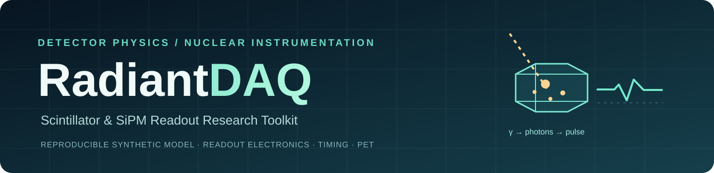
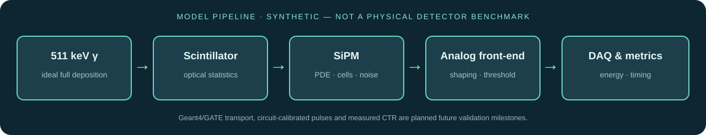
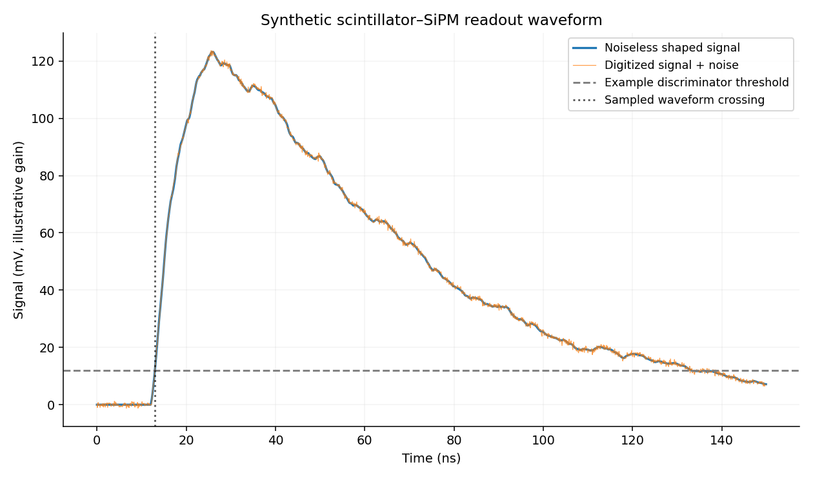
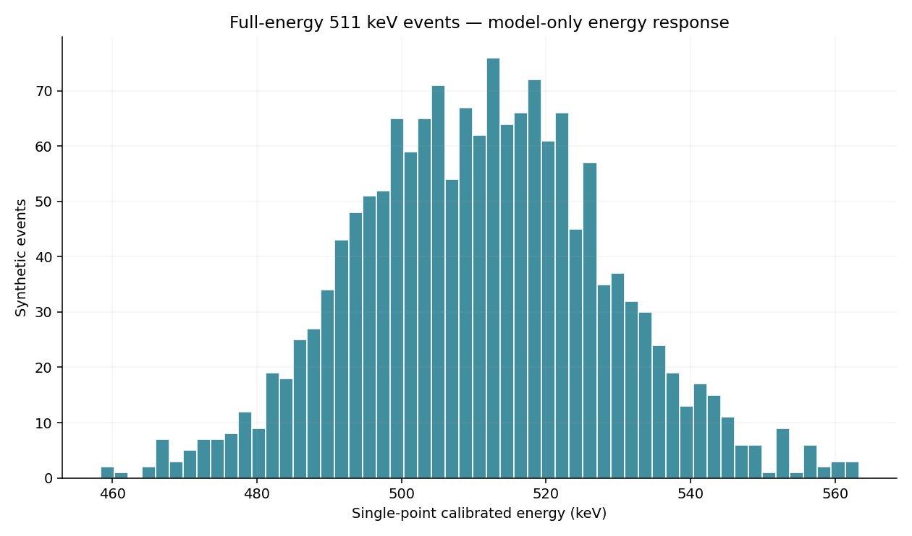
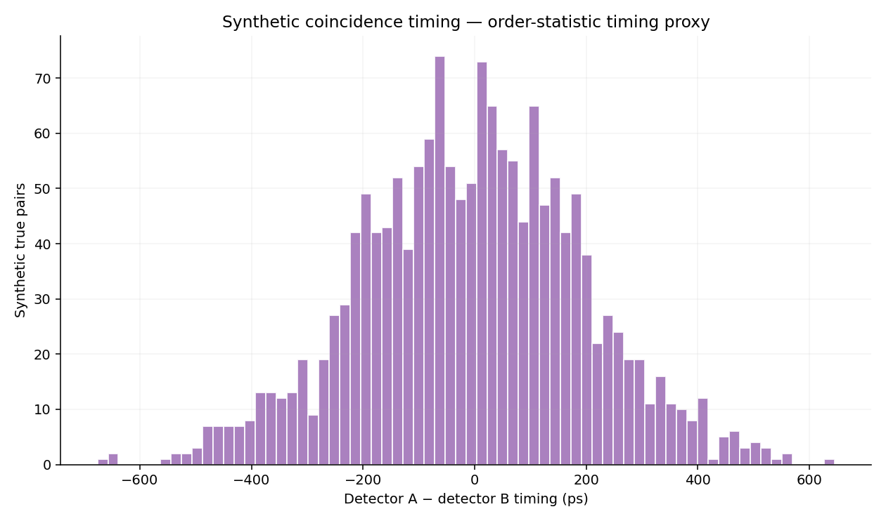
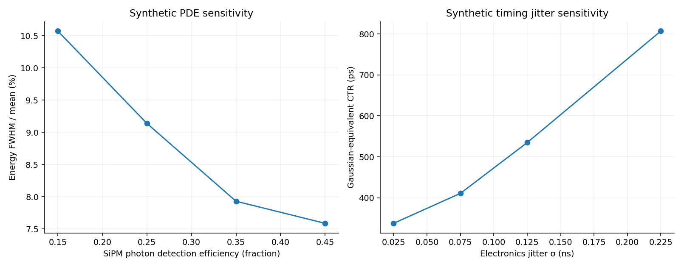

<div align="center">



# RadiantDAQ
### Scintillator & SiPM Readout Research Toolkit

**Detector Physics · Nuclear & Radiation Instrumentation · Medical Imaging R&D**


[](https://github.com/BurhanKARADUMAN/RadiantDAQ/actions)

*Connecting scintillation physics, photon detection, pulse formation, timing electronics and quantitative analysis — with explicit scientific limitations.*

</div>

> [!IMPORTANT]
> **Research prototype, not a medical device.** Every numeric output and figure in this repository is generated by an **illustrative synthetic model**. It is **not** measured sensor performance, a Geant4/GATE optical simulation, a validated PET scanner model or a clinical result. All model assumptions and data provenance are documented.

## Why RadiantDAQ?

The performance of PET and gamma detector systems depends on much more than identifying radiation interactions. Optical collection, SiPM gain and correlated noise, timing pick-off, discriminator behavior, acquisition hardware, and calibration all affect the final measurement. This project begins with a small **fully runnable** computational model, then provides an evidence-based roadmap to optical Monte Carlo, analog front-end development and bench validation.



## First milestone: implemented and tested

| Module | Implemented in v0.1 | Scientific scope |
|---|---|---|
| Full-energy scintillation | Poisson detected photons with adjustable collection and PDE | Every event is assumed to deposit exactly 511 keV |
| Finite SiPM cells | Binomial microcell occupancy, one-step crosstalk and dark counts | No recovery or afterpulsing |
| Charge / energy | Gaussian charge noise and idealized 511-keV one-point calibration | Not a spectral or absolute-energy calibration |
| Timing | k-th photon time + independent SPTR/electronics jitter | A timing **proxy**, not a waveform CFD/TDC simulation |
| Analog waveform | Binned photon arrivals convolved with a shaped impulse; sampled threshold | Illustrative voltages, unvalidated equivalent circuit |
| Performance metrics | Gaussian-equivalent energy FWHM, CTR, true-pair timing-window acceptance | Not measured detector efficiency or scanner sensitivity |
| Reproducibility | JSON/CSV, seeded simulations, automated `pytest` and CI | Software checks only |

## Example results — synthetic only

<table>
<tr><td width="50%"></td><td width="50%"></td></tr>
<tr><td><sub>Illustrative voltage pulse shape, baseline noise and example sampled discriminator crossing.</sub></td><td><sub>Model-only full-energy response. No Compton continuum or detector measurement.</sub></td></tr>
<tr><td></td><td></td></tr>
<tr><td><sub>Two independent synthetic detector-chain timing proxies for simultaneous 511-keV interactions.</sub></td><td><sub>Separate software experiments changing PDE or electronics jitter.</sub></td></tr>
</table>

Reproduce these figures with the commands below. [The generated metadata](examples/demo/summary.json) includes the seed, configuration and assumptions.

## Quick start

Requires Python 3.10+.

```bash
python -m venv .venv
# Windows PowerShell: .\.venv\Scripts\Activate.ps1
# Linux / WSL: source .venv/bin/activate
python -m pip install -e '.[test]'
python -m pytest -q
radiantdaq demo --events 1600 --seed 2026 --out outputs/demo
radiantdaq sweep --events 1100 --seed 2026 --out outputs/demo
```

On Windows PowerShell, the above Unix-style single quotes around `.[test]` are also accepted by PowerShell.

If `radiantdaq` is not on PATH, use `python -m radiantdaq demo ...`.

### Available inputs

`--events`: number of idealized two-detector full-energy true events; `--seed`: random seed; `--out`: output directory; `--coincidence-window-ns`: **full** timing window width for the toy coincidence selector. Defaults are illustrative.

### Example results directory

```text
outputs/demo/
├── summary.json                     reproducibility metadata and metrics
├── event_level_synthetic.csv        2-channel artificial event records
├── sample_waveform.csv              separate demonstration waveform
├── synthetic_parameter_sweep.csv    two parameter sweeps (after sweep command)
├── 01_sipm_waveform.png
├── 02_energy_response.png
├── 03_timing_difference.png
└── 04_parameter_sensitivity.png
```

## Scientific methods

- [Model details and equations](docs/METHODS.md)
- [Validation ladder: Python → GATE → LTspice → detector bench](docs/VALIDATION.md)
- [Readout electronics and DAQ roadmap](docs/ELECTRONICS_ROADMAP.md)
- [Data provenance](docs/DATA_PROVENANCE.md)
- [Technical references](docs/REFERENCES.md)

In the present MVP, *model settings are not vendor-calibrated*. Manufacturer resources distinguish PDE, dark count rate, correlated crosstalk, afterpulsing and system-level coincidence timing. RadiantDAQ intentionally does **not** claim to model all of these to full device fidelity. See [Hamamatsu MPPC characterization guidance](https://hub.hamamatsu.com/us/en/technical-notes/mppc-sipms/a-technical-guide-to-silicon-photomutlipliers-MPPC-Section-4.html).

## Roadmap

- [x] v0.1 — synthetic photon statistics, SiPM occupancy, timing proxy, waveform and parameter sweeps
- [ ] v0.2 — event-level scintillation/SiPM pulse model with correlated noise and recharge
- [ ] v0.3 — leading-edge vs CFD timing **from the same waveforms**, plus timing calibration
- [ ] v0.4 — Geant4/GATE 511-keV gamma and optical photon transport with reference datasets
- [ ] v0.5 — LTspice/PCB readout and hardware characterization with calibrated test signals
- [ ] v1.0 — measured SiPM datasets, uncertainty analysis and well-defined PET module performance metrics

## Repository map

```text
src/radiantdaq/            event, timing, waveform and CLI code
tests/                     unit and integration tests
examples/demo/             generated, clearly synthetic sample outputs
docs/                      methods, research audit, hardware and validation roadmap
.github/workflows/        Python tests (GitHub Actions)
PUBLISH_NEW_REPOSITORY.ps1  new-repository-only publisher for Windows
```

## Author and citation

**Burhan Karaduman** · Physics Undergraduate, Middle East Technical University (METU), Türkiye.  
Research interests: detector physics, nuclear and radiation instrumentation, advanced medical imaging systems and instrumentation development.  
Contact: [LinkedIn](https://www.linkedin.com/in/burhan-karaduman-57b348362/) · [GitHub research portfolio](https://burhankaraduman.github.io/)

Citation metadata: [CITATION.cff](CITATION.cff). This project is open-source research software and does not claim peer-reviewed publication or medical validation.
