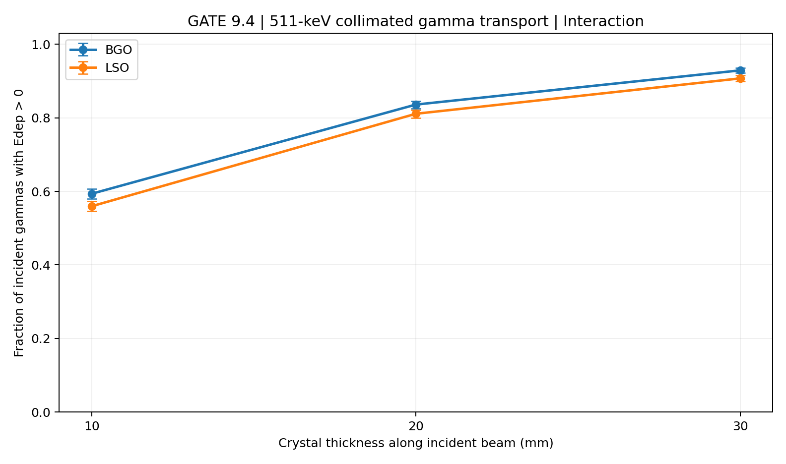
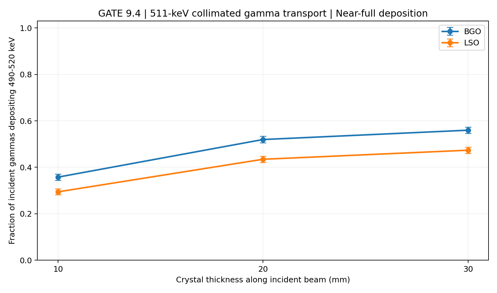
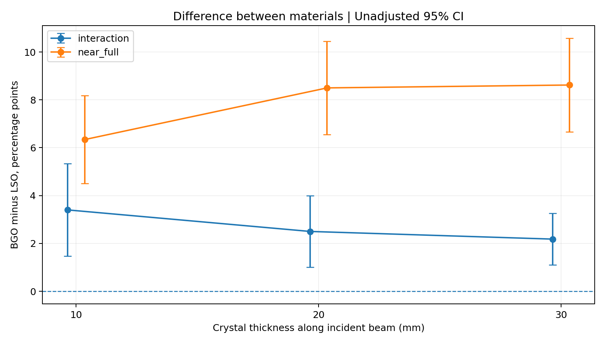
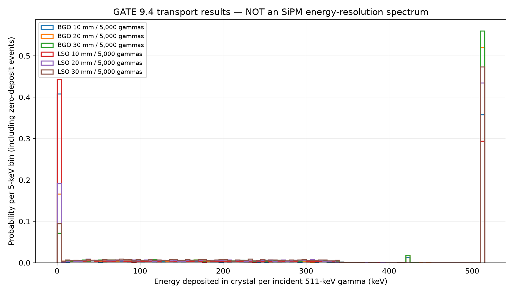

# GATE 9.4 - 511-keV LSO vs BGO Gamma Transport (30k primaries)

**Status:** User-executed GATE 9.4 simulation results, independently validated *at the CSV calculation level*.  
**Scope:** Radiation transport in a 3 x 3 mm crystal; **not** an optical, SiPM, measured detector or clinical PET simulation.

[Full research report](RESEARCH_REPORT.md) | [Four-page PDF](Research_Report.pdf) | [Raw derived event data](data/) | [Reproducible analysis script](scripts/validate_and_plot.py)

## Results

| Crystal | Thickness | P(any crystal Edep) | P(490-520 keV crystal Edep) |
|:--|--:|--:|--:|
| BGO | 10 mm | 59.36% | 35.76% |
| BGO | 20 mm | 83.62% | 51.96% |
| BGO | 30 mm | 92.92% | 55.98% |
| LSO | 10 mm | 55.96% | 29.42% |
| LSO | 20 mm | 81.12% | 43.46% |
| LSO | 30 mm | 90.74% | 47.36% |

## Main figures









All values are conditional on a mono-directional 511-keV source aimed at an isolated 3 x 3 mm crystal, with one seed per configuration, and include zero-energy events in the incident denominator. The apparent 511-keV peak is **not** an energy-resolution measurement; no scintillation optical photon propagation, sensor PDE or timing chain was simulated. Raw ROOT Hits, source macros, materials DB and run logs remain on the user's WSL system and should be archived for fully reproducible Geant4-level evidence.

## Reproduce analysis of these exported results

```bash
python scripts/validate_and_plot.py
```

Requires Python, NumPy and Matplotlib (provided by the RadiantDAQ development environment). Recalculates event counts, uncertainties and graphs from the six original event CSVs without rerunning GATE.

The script aborts when any provided CSV sample count, source aggregate, or physical energy bound does not agree with the original metrics. See `data/validation_metadata.json` for assumptions and `RESEARCH_REPORT.md` for reproducibility caveats.
